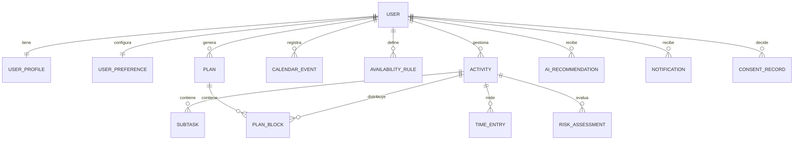

# Contexto definitivo de la aplicación

## 1. Identidad del producto

**Nombre de trabajo:** Planificador Estudiantil Inteligente.

**Público inicial:** estudiantes de la Universidad Estatal de Bolívar. La solución no depende de una base institucional y puede generalizarse posteriormente.

**Propuesta central:** la aplicación conoce qué debe hacer el estudiante, cuánto tiempo tiene disponible y lo ayuda a construir y reajustar un plan realizable sin quitarle control.

## 2. Problema

Una lista de tareas o calendario genérico permite registrar fechas, pero no necesariamente relaciona:

- carga pendiente;
- tiempo estimado;
- tiempo realmente disponible;
- eventos fijos;
- progreso;
- fecha límite;
- margen temporal;
- riesgo de retraso.

El estudiante puede tener toda la información registrada y aun así no saber si alcanzará a cumplirla.

## 3. Objetivos

1. Centralizar actividades académicas, personales y cotidianas.
2. Construir planes diarios y semanales que respeten restricciones reales.
3. Detectar falta de capacidad antes del plazo.
4. Permitir reajustar sin perder historial ni aplicar cambios silenciosos.
5. Comparar tiempo estimado y tiempo real.
6. Mantener privacidad, consentimiento y control humano.

## 4. No objetivos del MVP

- Reemplazar Moodle o convertirse en un LMS.
- Integrarse con la base institucional.
- Gestionar calificaciones oficiales.
- Ser una red social.
- Crear un chatbot general.
- Resolver o generar tareas académicas.
- Aplicar decisiones sin confirmación.
- Importar cualquier documento arbitrario.
- Añadir gamificación compleja.
- Convertirse en Notion + calendario + LMS + red social.

## 5. Roles

### Estudiante

- administra perfil, actividades y disponibilidad;
- consulta agenda, calendario, riesgo y estadísticas;
- registra sesiones de trabajo;
- recibe recordatorios y recomendaciones;
- acepta, modifica o rechaza propuestas;
- controla consentimiento y eliminación de cuenta.

### Administrador

- administra estado de cuentas;
- configura proveedores y modelos de IA;
- asigna modelos a casos de uso;
- revisa auditoría, salud y uso técnico;
- publica documentos de privacidad;
- no ve secretos guardados ni datos privados sin una operación autorizada y auditada.

## 6. Alcance MVP

### Cuenta, privacidad y preferencias

- registro, inicio/cierre y recuperación de acceso;
- perfil, idioma y zona horaria;
- preferencias de jornada, sesiones y notificaciones;
- consentimiento versionado para términos, privacidad e IA;
- revocación de IA sin perder funciones manuales;
- solicitud de exportación y eliminación.

### Organización académica

- materias y periodos académicos fueron retirados del producto (sus tablas se conservan solo para exportar o eliminar datos existentes);
- clases y compromisos fijos;
- actividades académicas, exámenes, personales y rutinas;
- subtareas;
- recurrencia básica;
- prioridad, fecha límite, inicio mínimo, estimación, progreso y estado.

### Disponibilidad

- reglas semanales;
- excepciones por fecha;
- eventos fijos;
- jornada y duración mínima/máxima de sesión;
- detección de solapamientos.

### Agenda y calendario

- vista diaria;
- vista semanal;
- vista mensual resumida;
- lista de próximas actividades;
- bloques de trabajo diferenciados de fechas límite.

### Planificación

- generar una vista previa para un horizonte;
- dividir actividades largas en bloques;
- respetar disponibilidad, eventos, plazos y bloques bloqueados;
- mostrar actividades o minutos que no pudieron ubicarse;
- permitir editar la propuesta;
- aplicar explícitamente;
- mantener historial de versiones;
- bloquear bloques que no deben moverse.

### Ejecución y medición

- iniciar/detener una sesión;
- registrar tiempo manual;
- actualizar progreso;
- comparar estimado y real;
- mostrar estadísticas básicas por semana y actividad.

### Riesgo

- calcular trabajo restante;
- calcular capacidad disponible antes del plazo;
- calcular margen o déficit;
- clasificar riesgo;
- explicar las razones;
- alertar solo cuando cambia el nivel o termina el periodo de enfriamiento.

### IA acotada

- extraer campos desde texto o voz, con confirmación;
- sugerir duración cuando el usuario lo solicita;
- explicar riesgo con datos determinísticos;
- explicar cambios de una replanificación;
- proponer subtareas sin crearlas automáticamente;
- configurar proveedor/modelo desde admin.

### Notificaciones

- recordatorio de bloque próximo;
- recordatorio de plazo;
- alerta de riesgo;
- cambio relevante de plan;
- preferencias, anticipación y horas silenciosas.

## 7. Roadmap posterior

Solo tras validar el MVP:

- importar horario desde imagen/PDF con revisión;
- sincronizar calendarios externos;
- widgets;
- modelos de estimación más personalizados;
- exportación ampliada;
- integración institucional como proyecto separado.

## 8. Modelo de dominio



## 9. Reglas de negocio

### Actividades

- Toda actividad pertenece a un usuario.
- La fecha límite indica cuándo debe estar terminada; no es el momento de trabajo.
- `progressPercent` está entre 0 y 100.
- Completar fija progreso en 100 y registra `completedAt`.
- Reabrir crea historial.
- El tiempo real se deriva de sesiones cerradas.
- Una actividad recurrente genera instancias; no se modifica retroactivamente toda la serie sin confirmación.

### Disponibilidad

- Se interpreta en la zona horaria del usuario.
- Un intervalo que cruza medianoche se divide.
- Las excepciones tienen prioridad sobre reglas semanales.
- Eventos fijos y bloques bloqueados restan capacidad.
- Un bloque no puede ubicarse fuera de disponibilidad.

### Planes

- Un plan `draft` es una vista previa.
- Aplicar crea una nueva versión activa y reemplaza la anterior.
- Los bloques bloqueados se conservan salvo conflicto imposible.
- El usuario ve diferencias antes de aceptar.
- Ningún texto generado por IA tiene autoridad para aplicar cambios.
- Un plan puede contener trabajo no asignado con razón explícita.

### Tiempo real

- Solo puede existir una sesión abierta por usuario.
- Cerrar sesión calcula duración en servidor.
- Ediciones manuales se auditan.
- El tiempo de una sesión pertenece a una actividad.

### Riesgo

Para una actividad con plazo:

```text
trabajo_restante = max(0, estimado_ajustado - tiempo_real_util)
capacidad_disponible = suma de huecos utilizables antes del plazo
margen = capacidad_disponible - trabajo_restante
```

Clasificación inicial:

- **bajo:** margen suficiente y sin conflicto;
- **medio:** margen positivo reducido o dependencia de pocos huecos;
- **alto:** margen negativo, plazo vencido o conflicto imposible.

Los umbrales se versionan y prueban. Un LLM no decide el nivel.

### IA

- Toda salida se valida contra un esquema.
- La IA sugiere; el servidor valida y el usuario decide.
- La explicación recibe métricas estructuradas y no puede alterarlas.
- El fallo de IA no bloquea CRUD, planificación ni riesgo.
- El fallback entre proveedores es explícito y auditado.
- No se envía PII innecesaria.

## 10. Motor de planificación MVP

### Entradas

- actividades pendientes;
- prioridad;
- fecha límite e inicio mínimo;
- trabajo restante;
- disponibilidad y excepciones;
- eventos fijos;
- bloques bloqueados;
- duración mínima/máxima;
- máximo diario;
- horizonte.

### Pasos

1. Convertir instantes a UTC conservando la zona IANA.
2. Construir intervalos disponibles por día.
3. Restar eventos y bloques bloqueados.
4. Calcular trabajo restante y riesgo preliminar.
5. Ordenar por restricciones: vencimiento, déficit, prioridad y antigüedad.
6. Dividir en sesiones válidas.
7. Asignar a huecos antes del plazo.
8. Registrar trabajo no asignado.
9. Recalcular riesgo.
10. Guardar un plan `draft` con versión del algoritmo.

```text
freeSlots = buildFreeSlots(availability, exceptions, events, lockedBlocks)
activities = rankActivities(pendingActivities)

for activity in activities:
  remaining = remainingMinutes(activity, timeEntries)
  chunks = splitIntoChunks(remaining, preferences)

  for chunk in chunks:
    slot = findBestSlot(chunk, activity.deadline, freeSlots)
    if slot:
      allocate(chunk, slot)
      shrink(slot)
    else:
      markUnscheduled(activity, chunk)

return draftPlan + riskAssessments
```

## 11. Flujos críticos

### Crear actividad

1. Captura manual o frase.
2. Si usa IA, mostrar campos propuestos.
3. Revisar título, plazo, estimación y prioridad.
4. Confirmar.
5. API valida y guarda.
6. Recalcular riesgo.

### Replanificar

1. Solicitar preview.
2. Mostrar movimientos, nuevos bloques y trabajo no ubicado.
3. Permitir mover, bloquear o quitar bloques de la propuesta.
4. Confirmar.
5. Aplicar en transacción con control de versión.

### Completar trabajo

1. Iniciar sesión o registrar tiempo.
2. Cerrar y calcular duración.
3. Actualizar progreso.
4. Recalcular trabajo restante y riesgo.
5. Actualizar estadísticas.

### Revocar IA

1. Registrar revocación.
2. Deshabilitar endpoints y jobs de IA para el usuario.
3. Conservar funciones manuales y determinísticas.
4. Eliminar/retener datos conforme a política.

## 12. API conceptual

Base `/v1`.

### Identidad

- `POST /auth/register`
- `POST /auth/sign-in`
- `POST /auth/sign-out`
- `POST /auth/recover`
- `GET /me`
- `PATCH /me/profile`
- `PATCH /me/preferences`

### Dominio

- `/calendar-events`
- `/activities`
- `/availability-rules`
- `/availability-exceptions`
- `/time-entries`
- `/risk-assessments`
- `/notifications`

### Planificación

- `POST /plans/preview`
- `PATCH /plans/{id}/blocks/{blockId}`
- `POST /plans/{id}/apply`
- `POST /plans/{id}/reject`
- `GET /plans/active`
- `GET /plans/history`

### IA

- `POST /ai/task-extraction`
- `POST /ai/duration-estimate`
- `POST /ai/task-breakdown`
- `POST /ai/recommendations/{id}/accept`
- `POST /ai/recommendations/{id}/reject`

### Admin

- `/admin/users`
- `/admin/ai/providers`
- `/admin/ai/routes`
- `/admin/ai/usage`
- `/admin/audit`
- `/admin/privacy-documents`
- `/admin/system-health`

## 13. Convenciones API

- UUID públicos.
- Fechas ISO 8601 UTC.
- Zona horaria IANA en perfil.
- `Idempotency-Key` en mutaciones reintentables.
- `version` en recursos sincronizables.
- Conflicto de versión: `409`.
- Validación: `422`.
- Error Problem Details:

```json
{
  "type": "https://example.local/problems/version-conflict",
  "title": "La actividad cambió en otro dispositivo",
  "status": 409,
  "detail": "Actualiza los datos antes de guardar nuevamente.",
  "code": "VERSION_CONFLICT",
  "requestId": "req_...",
  "errors": []
}
```

## 14. Offline

El MVP es offline-tolerant, no totalmente offline-first.

Permitido sin conexión:

- leer caché;
- crear/editar actividad;
- actualizar progreso;
- registrar una sesión manual;
- ver el último plan.

Requiere conexión:

- autenticación inicial;
- generar/aplicar plan;
- IA;
- recuperación;
- admin.

Cada mutación local contiene `clientMutationId`, `baseVersion`, payload y fecha. Los conflictos relevantes no se resuelven silenciosamente.

## 15. Seguridad

- Hash Argon2id a través de la solución de auth.
- Sesiones rotatorias y revocables.
- TLS.
- Secrets en secret manager o cifrado envelope.
- Alcance por `user_id`.
- Rate limiting en auth, IA y admin.
- Auditoría de operaciones sensibles.
- No logs con PII/secrets.
- Usuario de migración separado del runtime.
- Backups cifrados y restauración probada.

## 16. Privacidad

- Consentimientos separados: términos, privacidad e IA.
- Revocar IA no elimina la cuenta.
- Minimizar datos enviados.
- No enviar email, nombre o ID institucional si no son necesarios.
- Registrar versión y fecha.
- Definir retención antes de producción.
- Permitir borrado y exportación.

## 17. Accesibilidad

- Objetivos táctiles de al menos 48 dp.
- Etiquetas accesibles.
- Tamaño de fuente del sistema.
- No usar color como único indicador.
- Orden de foco.
- Animaciones reducibles.
- Pruebas con lector de pantalla en crear actividad y aplicar plan.

## 18. Rendimiento inicial

- CRUD API p95 ≤ 500 ms bajo carga objetivo documentada.
- Preview determinístico p95 ≤ 2 s en horizonte estándar.
- Primera pantalla útil tras restaurar sesión ≤ 3 s en dispositivo objetivo.
- IA con timeout configurable y fallback manual.
- Listas paginadas/virtualizadas.
- No ejecutar motor principal en hilo JS móvil.

## 19. Observabilidad

- Logs JSON con request/trace ID y redacción.
- Métricas de latencia, error, outbox, notificaciones, IA y costo.
- Trazas API → DB → worker → proveedor.
- Crash reporting móvil sin contenido privado.
- Alertas por backlog, proveedor caído, costo anormal y error sostenido.

## 20. Panel administrativo de IA

Debe permitir:

- crear conexión;
- guardar key sin volver a mostrarla;
- probar con datos sintéticos;
- habilitar/deshabilitar;
- registrar modelos por ID;
- asignar modelo por caso de uso;
- timeout, límite de salida, presupuesto y fallback;
- métricas de salud, latencia, error y consumo;
- auditoría.

No debe permitir:

- prompts arbitrarios sin versionado/revisión;
- pruebas con datos reales por defecto;
- recuperar una key en texto plano;
- habilitar un modelo para todo accidentalmente.

## 21. Criterios transversales

- Toda consulta privada verifica propietario.
- Toda recomendación se identifica como IA.
- Toda replanificación muestra diferencias.
- El sistema manual funciona sin IA.
- Fechas y notificaciones respetan zona horaria.
- Ningún secreto aparece en bundle, respuesta o log.
- La eliminación lógica no rompe historial ni auditoría.
