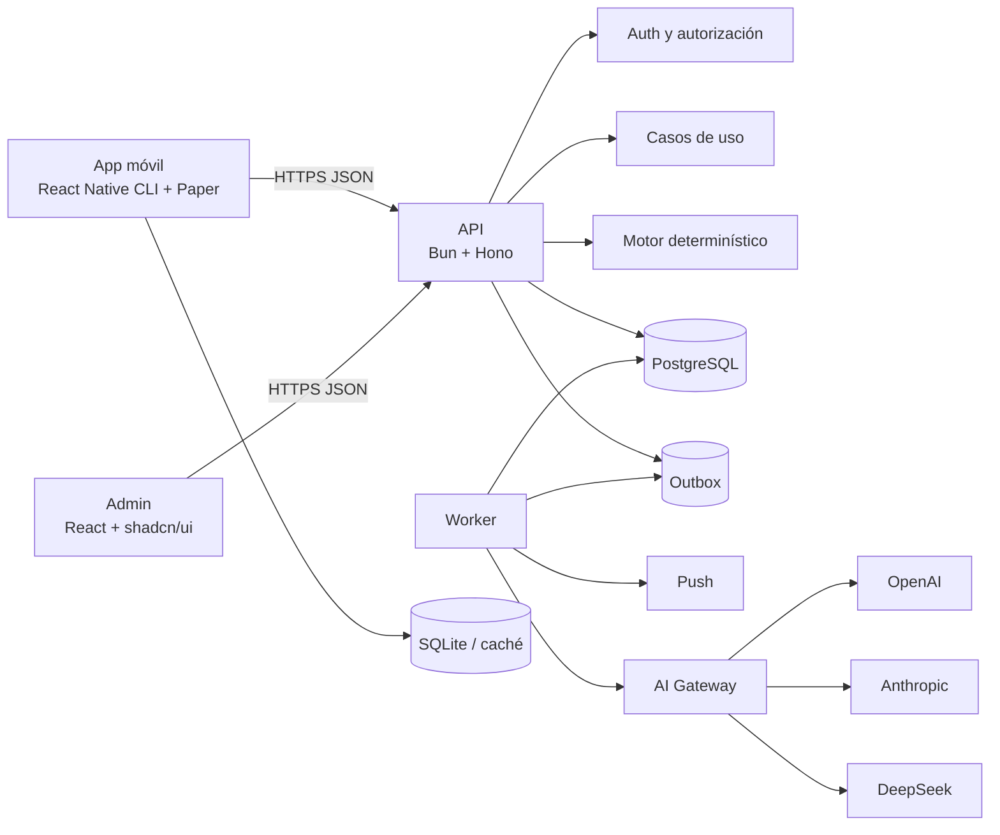
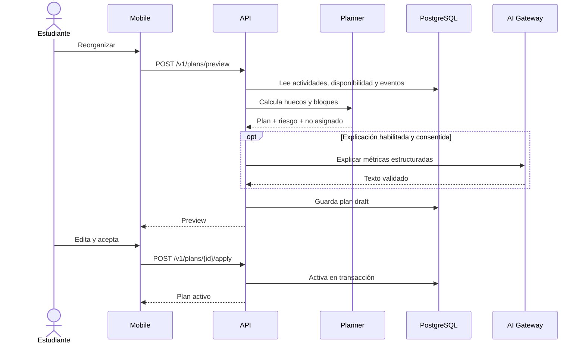

# Arquitectura del sistema

## Vista general



## Responsabilidades

### Mobile

- experiencia del estudiante;
- caché y mutaciones offline permitidas;
- agenda, actividades, disponibilidad, preview y ejecución;
- almacenamiento seguro de sesión;
- nunca contiene secretos ni reglas de autorización.

### Admin

- cuentas, configuración IA, documentos, auditoría y salud;
- no accede directamente a DB;
- no recupera secrets guardados.

### API

- autenticación y autorización;
- validación;
- transacciones;
- casos de uso;
- motor de planificación y riesgo;
- contratos;
- auditoría y outbox.

### Worker

- notificaciones;
- jobs de IA;
- procesamiento del outbox;
- tareas programadas;
- reintentos y dead-letter operativo.

### PostgreSQL

Fuente de verdad. Redis, si se añade, sirve para cache, rate limit, coordinación o cola; nunca sustituye la persistencia transaccional.

## Monorepo

```text
apps/
  mobile/
  admin/
  api/
  worker/
packages/
  contracts/
  domain/
  db/
  config/
  observability/
```

Se usan workspaces de Bun. No se añade un orquestador adicional sin beneficio medido y ADR.

## Módulos API

```text
apps/api/src/
  app/
  middleware/
  modules/
    auth/
    users/
    subjects/
    activities/
    calendar/
    availability/
    planning/
    time-tracking/
    risk/
    notifications/
    privacy/
    ai/
    admin/
  shared/
```

Flujo pragmático:

```text
route -> validator -> use case -> repository -> PostgreSQL
                         |-> domain service
                         |-> audit/outbox
```

No crear una clase por cada función. Las abstracciones obligatorias son fronteras externas o variantes reales: DB, reloj, IDs, notificaciones, secrets y proveedores IA.

## Módulos mobile

```text
apps/mobile/src/
  navigation/             # React Navigation
  core/
    api/
    auth/
    config/
    errors/
    storage/
    theme/
  features/
    activities/
    subjects/
    calendar/
    availability/
    planning/
    time-tracking/
    notifications/
    settings/
  shared/
```

Cada feature crea solo carpetas necesarias: `api`, `components`, `hooks`, `screens`, `schemas`, `types`, `__tests__`.

## Estado mobile

- **TanStack Query:** datos del servidor, cache, invalidación y mutations.
- **Zustand:** estado efímero como filtros o borrador de preview; no duplicar recursos del servidor.
- **React Hook Form + Zod:** formularios.
- **Android Keystore/iOS Keychain:** cookie de sesión mediante react-native-keychain.
- **SQLite:** cache y outbox local acotado.

## Flujo de replanificación



## Motor determinístico

Debe ser una librería pura dentro de `packages/domain/planning` con entradas/salidas serializables, reloj inyectado y versión explícita.

Submódulos sugeridos:

- intervalos;
- expansión de recurrencia;
- disponibilidad;
- ranking;
- chunking;
- asignación;
- riesgo;
- validación de invariantes.

Invariantes:

- ningún bloque activo se solapa;
- todo bloque cabe en disponibilidad;
- no cruza un evento fijo;
- duración positiva;
- no asigna más trabajo del restante;
- misma entrada + versión produce mismo resultado.

## Contratos

`packages/contracts` contiene:

- schemas Zod;
- DTO públicos;
- tipos derivados;
- códigos de error;
- paginación;
- Problem Details.

No contiene:

- filas Drizzle;
- entidades con métodos;
- secretos;
- lógica de acceso.

El OpenAPI se genera o se valida contra estos contratos. No mantener dos contratos divergentes.

## Autenticación

Selección base: Better Auth en la API y cliente React Native sin Expo. Reglas:

- el esquema de auth se genera desde la versión real;
- mobile almacena la cookie de sesión solo en Android Keystore/iOS Keychain;
- admin usa cookie HttpOnly/Secure;
- sesiones revocables;
- password reset de un solo uso;
- MFA admin antes de producción;
- ninguna ruta confía en rol del cliente.

## Manejo de errores

Modelo:

```ts
type Problem = {
  type: string;
  title: string;
  status: number;
  code: string;
  detail?: string;
  requestId: string;
  errors?: Array<{ path: string; message: string }>;
};
```

Códigos estables:

- `AUTH_REQUIRED`
- `FORBIDDEN`
- `NOT_FOUND`
- `VALIDATION_FAILED`
- `VERSION_CONFLICT`
- `SCHEDULE_CONFLICT`
- `AI_UNAVAILABLE`
- `RATE_LIMITED`

No filtrar stack, SQL ni respuesta cruda del proveedor.

## Outbox y procesos externos

La mutación de dominio y el evento outbox se insertan en la misma transacción. El worker reclama filas con `FOR UPDATE SKIP LOCKED`, usa backoff, idempotencia y límite de intentos.

No se llama a push o IA dentro de una transacción de negocio.

## AI Gateway

```ts
interface AiGateway {
  generateStructured<T>(request: {
    useCase: AiUseCase;
    schema: unknown;
    payload: unknown;
    consentConfirmed: boolean;
    requestId: string;
  }): Promise<{
    value: T;
    provider: "openai" | "anthropic" | "deepseek";
    modelId: string;
    usage?: { inputTokens?: number; outputTokens?: number };
  }>;
}
```

Cada adaptador traduce autenticación, endpoint, formato, timeout, estructura, usage y errores. El dominio nunca importa SDK de proveedor.

## Admin

```text
apps/admin/src/
  app/
  features/
    users/
    ai-providers/
    ai-routing/
    audit/
    privacy/
    system-health/
  components/
  lib/
```

- Vite + React + shadcn/ui.
- TanStack Router/Query.
- React Hook Form + Zod.
- tablas paginadas desde servidor;
- acciones sensibles con confirmación;
- secretos write-only;
- test de proveedor con datos sintéticos.

## Observabilidad

- logs JSON estructurados;
- request/trace ID;
- métricas de latencia, error, outbox, push, IA y costo;
- OpenTelemetry o equivalente;
- crash reporting móvil con redacción;
- no capturar cuerpos privados.

## Despliegue conceptual

- API y worker como procesos separados;
- PostgreSQL administrado o con backup automatizado;
- secret manager;
- almacenamiento de artefactos si se añade importación;
- entornos dev/staging/prod;
- migración antes de activar código incompatible;
- health y readiness independientes.
