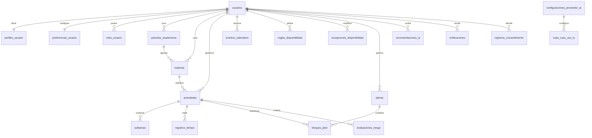

# Esquema de base de datos

El DDL de referencia se encuentra en `database/schema.sql`.

## Principios

- PostgreSQL 16+ como fuente transaccional.
- UUID públicos.
- `timestamptz` para instantes y zona IANA en preferencias.
- Clientes solo mediante API.
- `version` para control optimista.
- `eliminado_en` para entidades sincronizables que requieren tombstone.
- Auditoría y consentimiento append-only.
- Secretos fuera de texto plano.
- `jsonb` solo para payload flexible, no para evitar relaciones centrales.
- Todos los identificadores de base de datos (esquemas, tablas, columnas, tipos, índices, constraints, funciones, triggers) en español `snake_case`. Los valores de enums se mantienen en inglés porque viajan por la API.
- El esquema de dominio es `dominio`; el de autenticación es `autenticacion`.

## Entidades

### Identidad

| Tabla | Función |
|---|---|
| `usuarios` | Cuenta y estado. |
| `credenciales_autenticacion` | Hash de contraseña de referencia. |
| `sesiones_autenticacion` | Sesiones revocables. |
| `roles_usuario` | `student` y `admin`. |
| `perfiles_usuario` | Nombre mínimo, idioma y zona. |
| `preferencias_usuario` | Jornada, sesiones, notificaciones e IA. |

> Better Auth genera sus propias tablas. Sus nombres se renombran vía configuración (`modelName`/`fields`) a `autenticacion.usuarios`, `autenticacion.cuentas`, `autenticacion.verificaciones` y `autenticacion.almacen_seguro`, sustituyendo las tablas de autenticación de referencia y manteniendo `usuarios.id` como frontera del dominio o adaptando las FK mediante ADR.

### Académico

| Tabla | Función |
|---|---|
| `periodos_academicos` | Retirada del producto; se conserva solo para exportar o eliminar datos existentes. |
| `materias` | Retirada del producto; se conserva solo para exportar o eliminar datos existentes. |
| `eventos_calendario` | Clases y compromisos fijos. |

### Actividades

| Tabla | Función |
|---|---|
| `actividades` | Tarea académica, examen, personal o rutina. |
| `subtareas` | Desglose simple. |
| `historial_actividades` | Cambios relevantes. |
| `registros_tiempo` | Tiempo real. |

### Disponibilidad y planificación

| Tabla | Función |
|---|---|
| `reglas_disponibilidad` | Ventanas semanales. |
| `excepciones_disponibilidad` | Cambios por fecha. |
| `planes` | Versiones, incluida vista previa `draft`. |
| `bloques_plan` | Segmentos asignados. |
| `evaluaciones_riesgo` | Cálculo determinístico versionado. |

### IA

| Tabla | Función |
|---|---|
| `configuraciones_proveedor_ia` | Conexiones a OpenAI, Anthropic o DeepSeek. |
| `rutas_caso_uso_ia` | Modelo, límites y fallback por caso. |
| `recomendaciones_ia` | Salida estructurada y decisión. |
| `eventos_recomendacion_ia` | Historial de aceptación/rechazo. |
| `registros_uso_ia` | Tokens, costo, latencia y error sin prompt completo. |

### Notificaciones y privacidad

| Tabla | Función |
|---|---|
| `preferencias_notificacion` | Preferencias por tipo. |
| `notificaciones` | Programación, envío y lectura. |
| `documentos_privacidad` | Versiones de términos, privacidad e IA. |
| `registros_consentimiento` | Decisiones inmutables. |
| `solicitudes_eliminacion_cuenta` | Flujo de borrado. |

### Operación

| Tabla | Función |
|---|---|
| `registros_auditoria` | Acciones sensibles. |
| `claves_idempotencia` | Deduplicación de mutaciones. |
| `eventos_salida` | Entrega fiable a worker. |
| `configuracion_sistema` | Configuración global no secreta. |

## Relaciones



## Campos clave

### `actividades`

- `tipo`: `academic_task`, `exam`, `personal`, `routine`.
- `materia_id`: heredado; la aplicación ya no lo lee ni escribe (queda nulo en filas nuevas).
- `inicio_minimo`: no planificar antes.
- `fecha_limite`: fecha límite.
- `minutos_estimados`: estimación confirmada.
- `porcentaje_progreso`: 0–100.
- `prioridad`: baja, media, alta o crítica.
- `regla_recurrencia`: RFC 5545.
- `version`: sincronización optimista.
- `eliminado_en`: tombstone.

El tiempo real se obtiene de `registros_tiempo`; no se acepta como dato autoritativo de IA.

### `reglas_disponibilidad`

Una fila no cruza medianoche. Se divide cuando hace falta. Las excepciones tienen prioridad.

### `planes`

- `draft`: preview editable;
- `active`: versión aplicada;
- `superseded`: reemplazada;
- `rejected`/`expired`: no aplicable.

Un índice parcial permite solo un plan activo por usuario.

### `bloques_plan`

Contiene snapshot de título (`titulo_instantanea`) para conservar historial. Una restricción de exclusión evita solapamientos activos del mismo usuario.

### `evaluaciones_riesgo`

Guarda:

- trabajo restante;
- capacidad disponible;
- margen;
- nivel;
- razones estructuradas;
- versión de algoritmo.

### Configuración IA

La DB guarda `ref_secreto_credencial`, no la key. Puede apuntar a un secret manager o a un sobre cifrado administrado por servidor.

El modelo se almacena como string configurable. No se hardcodea “latest”.

## Datos sensibles

| Dato | Clasificación | Protección |
|---|---|---|
| Contraseña | Secreto | Solo hash Argon2id. |
| Sesión | Secreto | Hash servidor; token en SecureStore/cookie. |
| API key IA | Crítico | Secret manager/envelope; write-only. |
| Correo | Personal | Acceso limitado; no logs. |
| Actividad/agenda | Personal | No logs; minimizar ante IA. |
| Consentimiento | Legal | Append-only y versionado. |
| Auditoría | Sensible | Permiso admin y retención. |

## Índices esenciales

- usuario + estado + fecha límite en actividades;
- usuario + intervalo en eventos/bloques;
- plan activo parcial;
- una sesión de tiempo abierta;
- recomendaciones pendientes;
- notificaciones por estado/fecha;
- eventos de salida por estado/disponibilidad;
- auditoría por recurso/fecha.

## Constraints esenciales

- progreso 0–100;
- duraciones positivas;
- `termina_en > inicia_en`;
- plazo no anterior a inicio mínimo;
- una cuenta activa por correo;
- una ruta IA por caso;
- un plan activo por usuario;
- sin solapamiento de bloques activos;
- una sesión abierta por usuario.

## Soft delete

Usan `eliminado_en`:

- usuarios;
- periodos_academicos;
- materias;
- eventos_calendario;
- actividades;
- reglas/excepciones de disponibilidad.

No usan soft delete:

- consentimientos;
- auditoría;
- historial;
- uso IA;
- eventos de salida según retención.

## Alcance y autorización

Nunca:

```sql
SELECT * FROM actividades WHERE id = $1;
```

Siempre:

```sql
SELECT *
FROM actividades
WHERE id = $1
  AND usuario_id = $2
  AND eliminado_en IS NULL;
```

RLS puede añadirse como defensa en profundidad mediante ADR, pero no sustituye el scoping ni sus pruebas.

## Migraciones

- una migración por cambio coherente;
- no editar migraciones compartidas;
- expandir → migrar → contraer;
- índices grandes de forma concurrente cuando aplique;
- probar con DB limpia y datos realistas;
- documentar rollback lógico;
- actualizar este documento y el DDL de referencia.
