# Documentación del sistema NotesIA

> Documento maestro de producto, arquitectura y operación  
> **Sistema:** NotesIA — Planificador Estudiantil Inteligente  
> **Versión analizada:** `0.1.0`  
> **Fecha de corte:** 2026-10-06  
> **Alcance del análisis:** exclusivamente el repositorio `notesIA`

## 1. Propósito del documento

Este documento presenta una vista integral del sistema NotesIA a partir de su código, contrato OpenAPI, migraciones y documentación interna. Sirve como referencia para desarrollo, revisión funcional, pruebas, despliegue, soporte y evolución técnica.

Cuando existe una diferencia entre documentos históricos y la implementación, este documento prioriza, en orden:

1. migraciones y restricciones vigentes;
2. contrato `contracts/openapi.yaml` y esquemas Zod;
3. código ejecutable de API, worker, móvil y panel;
4. ADR aceptados;
5. documentos de producto y guías anteriores.

## 2. Resumen ejecutivo

NotesIA es un planificador personal para estudiantes. Relaciona tareas, tiempo estimado, progreso, disponibilidad semanal, excepciones, horas ocupadas y fechas límite para producir planes de estudio realizables y evaluar el riesgo de atraso.

El cálculo de disponibilidad, planificación y riesgo es determinístico. La inteligencia artificial se limita a extracción, estimación, explicación, propuesta de subtareas, onboarding y conversación asistida. Sus respuestas se validan, requieren consentimiento y no tienen autoridad para decidir permisos, conflictos, fechas, transacciones ni métricas del motor.

El producto está implementado como monorepo TypeScript con cuatro aplicaciones:

- app móvil React Native para estudiantes;
- panel web React para administración y soporte;
- API Bun/Hono como única frontera de acceso;
- worker para procesos diferidos, notificaciones, correo, push, planificación y mantenimiento.

PostgreSQL es la fuente de verdad. La app móvil usa SQLite cifrado para caché y cola offline acotada, y el almacén seguro del sistema operativo para la cookie de sesión.

## 3. Problema y propuesta de valor

Una lista de tareas informa qué hay que hacer, pero no responde si el tiempo disponible alcanza antes de cada plazo. NotesIA combina carga pendiente y capacidad real para:

- centralizar actividades académicas, personales y cotidianas;
- convertir trabajo estimado en bloques realizables;
- anticipar déficit de tiempo;
- registrar tiempo real y progreso;
- reorganizar el plan cuando cambian sus fuentes;
- conservar el control, privacidad e historial del estudiante.

## 4. Alcance del producto

### 4.1 Capacidades incluidas

- registro, verificación de correo, inicio y cierre de sesión;
- recuperación de contraseña y segundo factor para personal administrativo;
- perfil, avatar, idioma, zona horaria y preferencias;
- aceptación versionada de términos, privacidad e IA;
- actividades, subtareas, recurrencia diaria o semanal e historial;
- franjas de estudio, excepciones y horas ocupadas;
- agenda diaria, semanal y mensual;
- planificación determinística, edición de borradores e historial de planes;
- planificación automática del worker para usuarios con onboarding terminado;
- temporizador, tiempo manual, progreso y estadísticas;
- riesgo actual, avisos, rachas y descansos de racha;
- asistente de IA con acciones propuestas que el usuario revisa;
- notificaciones internas y push mediante Firebase Cloud Messaging;
- exportación y solicitud de eliminación de cuenta;
- reportes de problemas o sugerencias;
- administración de usuarios, roles, documentos, IA, avisos, reportes, auditoría y salud.

### 4.2 Fuera del alcance actual

- LMS, gestión de calificaciones o integración institucional;
- materias y periodos académicos: fueron eliminados por la migración `0052`;
- importación de horarios desde imagen o PDF;
- sincronización con calendarios externos;
- red social o colaboración entre estudiantes;
- resolución o generación de tareas académicas;
- planificación o autorización delegada a un modelo de IA;
- funcionamiento totalmente offline;
- cliente de escritorio o panel docente.

## 5. Actores y permisos

| Actor | Responsabilidades y acceso |
|---|---|
| Estudiante | Gestiona su perfil, horario, tareas, tiempo, planes, IA, avisos, reportes y privacidad. Solo accede a recursos asociados a su `user_id`. |
| Soporte | Accede al panel con MFA. Consulta usuarios y gestiona reportes. No administra proveedores, roles ni documentos. |
| Administrador | Accede al panel con MFA y sesión reciente. Gestiona cuentas, roles, IA, avisos, documentos, auditoría y salud. |
| Worker | Procesa outbox, correo, push, avisos programados, planificación, riesgo, eliminación y limpieza. |
| Proveedor de IA | OpenAI, Anthropic o DeepSeek, siempre detrás de `AiGateway`. |
| SMTP | Entrega verificación y recuperación cuando está configurado. |
| Firebase Cloud Messaging | Entrega push cuando existe configuración válida. |

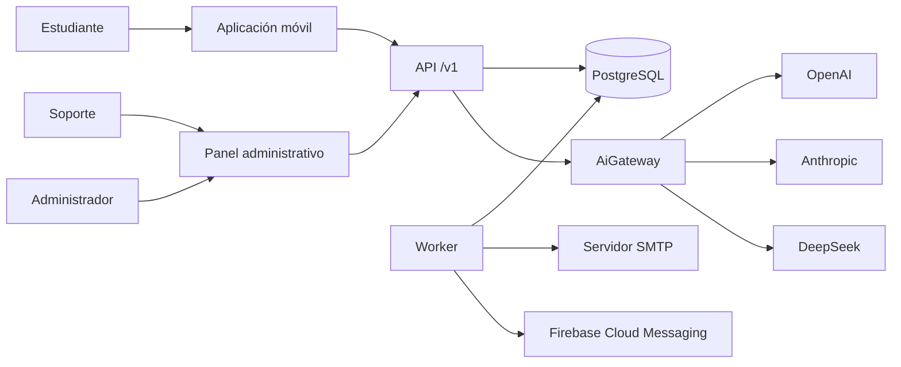

## 6. Requisitos funcionales consolidados

### 6.1 Identidad, perfil y privacidad

| ID | Requisito |
|---|---|
| RF-AUTH-01 | Registrar una cuenta con correo, contraseña de al menos 12 caracteres, avatar y aceptación de documentos obligatorios. |
| RF-AUTH-02 | Exigir verificación de correo antes de crear una sesión utilizable. |
| RF-AUTH-03 | Iniciar y cerrar sesiones revocables sin revelar información sensible. |
| RF-AUTH-04 | Recuperar contraseña mediante token de un solo uso y revocar sesiones previas. |
| RF-PROF-01 | Consultar y editar nombre, avatar, idioma y zona horaria con versión. |
| RF-PREF-01 | Configurar duración mínima y máxima de sesión, límite diario y horas silenciosas. |
| RF-PRIV-01 | Mostrar documentos legales vigentes y registrar decisiones inmutables por versión. |
| RF-PRIV-02 | Revocar el consentimiento de IA sin perder funciones manuales. |
| RF-PRIV-03 | Exportar datos con reautenticación. |
| RF-PRIV-04 | Solicitar y cancelar la eliminación durante el periodo de gracia configurado. |

### 6.2 Organización y ejecución

| ID | Requisito |
|---|---|
| RF-ACT-01 | Crear, consultar, editar y eliminar lógicamente actividades propias. |
| RF-ACT-02 | Clasificar actividades como tarea académica, examen, personal o rutina. |
| RF-ACT-03 | Mantener prioridad, inicio mínimo, plazo, estimación, progreso y estado. |
| RF-ACT-04 | Ejecutar transiciones comenzar, pausar, completar, cancelar y reabrir con historial. |
| RF-ACT-05 | Dividir una actividad en subtareas versionadas. |
| RF-ACT-06 | Crear series diarias o semanales de hasta 60 instancias. |
| RF-TIME-01 | Iniciar una sola sesión de tiempo abierta por usuario y detenerla con tiempo del servidor. |
| RF-TIME-02 | Registrar tiempo manual y consultar estadísticas en rangos de hasta 31 días. |
| RF-STRK-01 | Calcular racha actual, mejor racha, semana y semanas perfectas respetando días de descanso. |

### 6.3 Horario, planificación y riesgo

| ID | Requisito |
|---|---|
| RF-AVL-01 | Definir franjas semanales de estudio, incluidas ventanas que cruzan medianoche. |
| RF-AVL-02 | Sustituir la disponibilidad de una fecha mediante excepciones. |
| RF-CAL-01 | Registrar horas ocupadas de clase, trabajo, cita, personales, no disponibles u otras. |
| RF-PLN-01 | Generar una vista previa determinística para un horizonte máximo de 31 días. |
| RF-PLN-02 | Dividir trabajo en bloques según límites de sesión y máximo diario. |
| RF-PLN-03 | Restar horas ocupadas y respetar inicio mínimo, plazo y bloques bloqueados. |
| RF-PLN-04 | Informar minutos no asignados y su causa. |
| RF-PLN-05 | Permitir mover, bloquear o retirar bloques de un borrador y revalidarlo. |
| RF-PLN-06 | Aplicar o rechazar el borrador con control optimista e historial. |
| RF-PLN-07 | Recalcular automáticamente un plan de siete días tras el onboarding cuando cambian las fuentes o comienza otro día. |
| RF-RISK-01 | Calcular trabajo restante, capacidad, margen, nivel y razones sin usar IA. |
| RF-RISK-02 | Reevaluar riesgo después de cambios y limitar alertas repetidas mediante enfriamiento. |

### 6.4 IA, notificaciones y soporte

| ID | Requisito |
|---|---|
| RF-AI-01 | Extraer título y descripción de una actividad desde texto. |
| RF-AI-02 | Sugerir duración con una explicación breve. |
| RF-AI-03 | Explicar riesgo y replanificación sin cambiar hechos calculados. |
| RF-AI-04 | Proponer de una a ocho subtareas sin crearlas automáticamente. |
| RF-AI-05 | Asistir en onboarding y conversación con acciones estructuradas revisables. |
| RF-AI-06 | Aplicar timeout, presupuesto diario, validación, costo y fallback configurado. |
| RF-NOT-01 | Mantener un buzón de avisos de plan, plazo, bloque, riesgo, racha, reporte y anuncio. |
| RF-NOT-02 | Registrar dispositivos y entregar push si FCM está habilitado. |
| RF-REP-01 | Permitir al estudiante crear y consultar reportes. |
| RF-ADM-01 | Permitir a soporte atender reportes y consultar usuarios. |
| RF-ADM-02 | Permitir al administrador suspender cuentas y administrar roles con auditoría. |
| RF-ADM-03 | Gestionar proveedores, modelos y rutas de IA sin devolver claves guardadas. |
| RF-ADM-04 | Publicar documentos y enviar anuncios individuales o globales. |
| RF-ADM-05 | Consultar colas, worker, IA, costo, auditoría y alertas operativas. |

## 7. Requisitos no funcionales

| ID | Categoría | Requisito verificable |
|---|---|---|
| RNF-01 | Rendimiento | CRUD común p95 menor o igual a 500 ms bajo la carga objetivo documentada. |
| RNF-02 | Rendimiento | Preview determinístico p95 menor o igual a 2 s para el horizonte estándar. |
| RNF-03 | Seguridad | Ningún secreto debe aparecer en bundle, respuesta, telemetría o repositorio. |
| RNF-04 | Seguridad | Toda ruta privada debe rechazar falta de sesión, rol incorrecto y acceso cruzado. |
| RNF-05 | Integridad | Las mutaciones reintentables usan idempotencia; los recursos editables usan `version`. |
| RNF-06 | Tiempo | Instantes en UTC y presentación según zona IANA del perfil. |
| RNF-07 | Resiliencia | El flujo manual debe continuar cuando IA, push o SMTP no están disponibles. |
| RNF-08 | Offline | Una mutación aceptada localmente no se pierde al interrumpirse la red. |
| RNF-09 | Accesibilidad | Etiquetas, contraste, texto escalable, foco y objetivos táctiles de al menos 48 dp. |
| RNF-10 | Operación | Health y readiness separados; cierre ordenado; backup y restauración probados. |
| RNF-11 | Privacidad | Minimización de datos, consentimiento versionado y retención explícita. |
| RNF-12 | Compatibilidad | Los cambios públicos mantienen compatibilidad o versionan el contrato `/v1`. |

## 8. Stack tecnológico

| Capa | Tecnología principal | Uso |
|---|---|---|
| Runtime y monorepo | Bun `1.3.14` en imágenes; workspaces Bun | ejecución, scripts, build y pruebas |
| Lenguaje | TypeScript `~6.0.3`, modo estricto | todas las aplicaciones y paquetes |
| API | Hono `4.9.8` | HTTP JSON bajo `/v1` |
| Contratos | Zod `4.6.5`, OpenAPI generado | validación y DTO compartidos |
| Autenticación | Better Auth `1.7.5`, Argon2id | correo/contraseña, sesiones, TOTP |
| Persistencia | PostgreSQL 16+, `pg`, Kysely, Drizzle ORM | fuente de verdad y repositorios |
| Dominio temporal | `@js-temporal/polyfill` | zonas horarias y fechas locales |
| Móvil | React Native CLI `0.86.3`, React `19.2.3` | aplicación Android/iOS |
| UI móvil | React Native Paper `5.15.3` | único kit móvil |
| Navegación móvil | React Navigation `7` | navegación nativa |
| Estado remoto | TanStack Query `5.x` | caché e invalidación |
| Formularios | React Hook Form + Zod | captura y validación |
| Offline móvil | OP-SQLite `18.2.5` con SQLCipher | caché y outbox local |
| Sesión móvil | react-native-keychain `10.x` | Android Keystore/iOS Keychain |
| Push | React Native Firebase + FCM | registro y entrega push |
| Panel | React `19.2.3`, Vite `8.3.1` | SPA administrativa |
| UI panel | shadcn/ui, Radix UI, Tailwind CSS 4 | componentes accesibles |
| Ruteo panel | TanStack Router `1.170.39` | rutas del panel |
| Correo | Nodemailer `10.x` | verificación y recuperación |
| Calidad | Biome, Vitest, Jest, Testing Library, Playwright | lint y pruebas |
| Contenedores | Docker, Caddy 2 | API, worker y panel estático |
| Despliegue | Dokploy | servicios y variables de entorno |

## 9. Arquitectura

### 9.1 Vista de contenedores

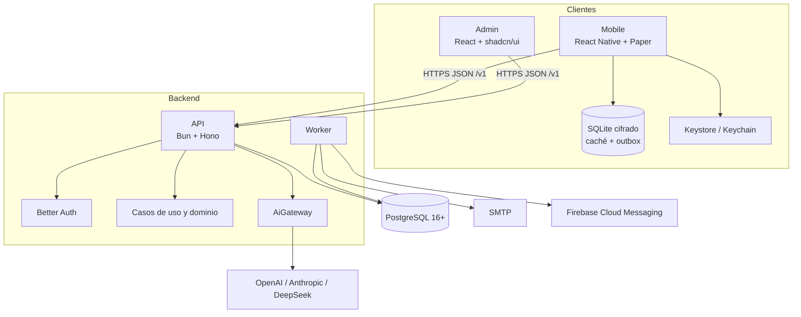

### 9.2 Responsabilidades por componente

| Componente | Responsabilidad | Límites |
|---|---|---|
| `apps/mobile` | Experiencia del estudiante, caché, cola offline, sesión segura, push y accesibilidad. | No autoriza, no accede a DB y no contiene claves de proveedores. |
| `apps/admin` | Operación administrativa y soporte. | Consume API con cookie; no accede a DB ni recupera secretos. |
| `apps/api` | Autenticación, autorización, validación, transacciones, dominio, contratos y auditoría. | Toda entrada del cliente se considera no confiable. |
| `apps/worker` | Procesos diferidos, correo, push, planificación, riesgo, limpieza y eliminación. | Reintentos acotados; no registra payloads privados. |
| `packages/contracts` | DTO, esquemas Zod, errores y paginación. | No contiene filas ORM ni secretos. |
| `packages/domain` | Lógica pura de disponibilidad, planificación, recurrencia, riesgo, tiempo, racha y mensajes push. | Sin IO ni dependencia de proveedor. |
| `packages/db` | Repositorios, transacciones, cifrado, migraciones y PostgreSQL. | Consultas personales siempre acotadas por usuario. |
| `packages/config` | Lectura y validación de configuración. | Falla temprano ante configuración inválida. |
| `packages/observability` | trazas, métricas, logs y alertas operativas. | Solo campos permitidos; sin PII ni cuerpos. |

### 9.3 Flujo interno de una petición

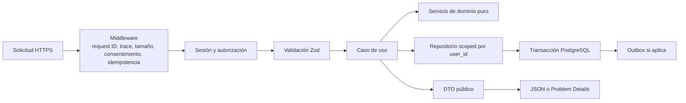

### 9.4 Estructura del monorepo

```text
notesIA/
├── apps/
│   ├── mobile/          # Aplicación del estudiante
│   ├── admin/           # Panel web
│   ├── api/             # API y autenticación
│   └── worker/          # Procesos diferidos
├── packages/
│   ├── contracts/       # Zod y DTO
│   ├── domain/          # Lógica determinística
│   ├── db/              # Persistencia y migraciones
│   ├── config/          # Configuración validada
│   └── observability/   # Logs, trazas y alertas
├── contracts/           # OpenAPI generado
├── database/            # DDL de referencia histórico
├── docs/                # Decisiones y guías especializadas
├── rules/               # Reglas locales de ingeniería
└── deploy/              # Configuración de Caddy
```

## 10. Modelo de dominio

### 10.1 Entidades principales

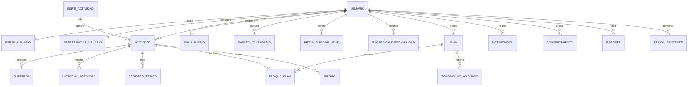

### 10.2 Estados de una actividad

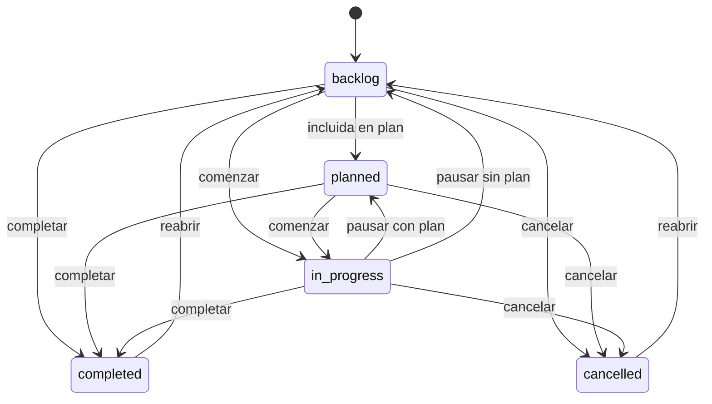

### 10.3 Reglas de negocio esenciales

- Toda entidad personal pertenece a un usuario y se consulta con `id + user_id`.
- El plazo expresa cuándo debe terminar el trabajo; no representa un bloque de trabajo.
- El progreso está entre 0 y 100; completar fija 100 y `completedAt`.
- Solo puede existir una sesión de tiempo abierta por usuario.
- El tiempo real se deriva de registros cerrados; su duración la genera PostgreSQL.
- Las excepciones sustituyen las reglas semanales para una fecha.
- Las horas ocupadas y bloques bloqueados restan capacidad.
- Un bloque debe caber en disponibilidad, no solaparse, respetar el plazo y no exceder el trabajo restante.
- Solo existe un plan activo por usuario.
- El mismo conjunto de entradas y versión del algoritmo produce el mismo resultado.
- La recurrencia soporta frecuencia diaria o semanal, máximo 366 días de rango y 60 ocurrencias.
- Consentimientos y auditoría son registros históricos; no se sobrescriben como estado mutable.

## 11. Motor de planificación y riesgo

### 11.1 Entradas

- actividades pendientes y su fecha de creación;
- prioridad, plazo e inicio mínimo;
- estimación, progreso y tiempo registrado;
- reglas y excepciones de disponibilidad;
- horas ocupadas y bloques bloqueados;
- zona horaria;
- duración mínima/máxima y máximo diario;
- horizonte y revisión de fuentes.

### 11.2 Algoritmo

La versión vigente se identifica como `deterministic-v2`.

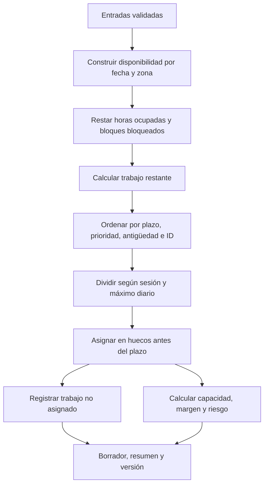

Trabajo restante:

```text
por_progreso = ceil(estimado × (100 - progreso) / 100)
por_tiempo   = max(0, estimado - floor(segundos_registrados / 60))
restante     = min(por_progreso, por_tiempo)
```

Riesgo:

```text
margen = capacidad_disponible_antes_del_plazo - trabajo_restante

alto  = plazo vencido, trabajo sin asignar o margen negativo
medio = margen menor que la duración máxima de una sesión
bajo  = capacidad suficiente con margen mayor
```

Las causas estructuradas incluyen `deadline_passed`, `work_unscheduled`, `capacity_deficit` y `low_margin`.

### 11.3 Plan manual

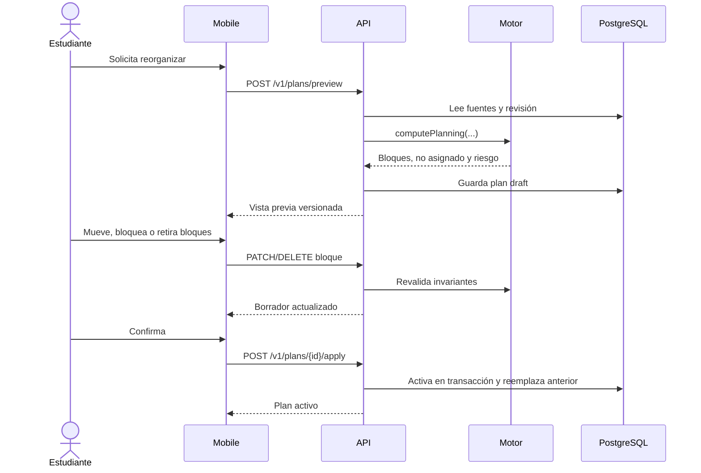

### 11.4 Plan automático implementado

Después de completar el onboarding y definir al menos una regla de disponibilidad, el worker revisa un usuario cuando cambia `revisiones_planificacion`, falta un registro previo o comienza un nuevo día local. Calcula desde hoy hasta siete días, crea un borrador y lo aplica con `notify: false`.

Esta conducta está implementada en `apps/worker/src/auto-planner.ts`, pero contradice el control explícito definido en `AGENTS.md`, `APP_CONTEXT.md` y ADR-0003. Se registra como desviación crítica en la sección 23.

## 12. Casos de uso

### 12.1 Catálogo

| CU | Actor | Caso de uso | Resultado |
|---|---|---|---|
| CU-01 | Estudiante | Registrar y verificar cuenta | Cuenta activa sin sesión automática tras verificar. |
| CU-02 | Estudiante | Iniciar/cerrar sesión | Cookie protegida y sesión revocable. |
| CU-03 | Estudiante | Completar onboarding | Perfil configurado, horario guardado y planificación habilitada. |
| CU-04 | Estudiante | Gestionar actividad | Actividad versionada e historial de transiciones. |
| CU-05 | Estudiante | Gestionar subtareas | Desglose versionado ligado a la actividad. |
| CU-06 | Estudiante | Crear recurrencia | Serie y sus instancias diarias o semanales. |
| CU-07 | Estudiante | Configurar horario | Capacidad semanal y excepciones por fecha. |
| CU-08 | Estudiante | Registrar hora ocupada | Intervalo que el planificador descuenta. |
| CU-09 | Estudiante | Generar y aplicar plan | Plan validado, activo y con historial. |
| CU-10 | Estudiante | Registrar tiempo | Sesión o entrada manual asociada a actividad. |
| CU-11 | Estudiante | Consultar progreso/riesgo | Métricas, racha, trabajo no asignado y alertas. |
| CU-12 | Estudiante | Usar asistente | Respuesta y acciones propuestas para revisión. |
| CU-13 | Estudiante | Gestionar privacidad | Consentimiento, exportación y eliminación. |
| CU-14 | Estudiante | Reportar un problema | Ticket visible para soporte. |
| CU-15 | Soporte | Atender reporte | Estado, asignación, respuesta e historial. |
| CU-16 | Administrador | Suspender/reactivar cuenta | Cambio versionado, sesiones anteriores invalidadas y auditoría. |
| CU-17 | Administrador | Configurar IA | Proveedor y ruta por caso sin exponer claves. |
| CU-18 | Administrador | Publicar documento | Nueva versión legal disponible para consentimiento. |
| CU-19 | Administrador | Enviar aviso | Notificación individual o global auditada. |
| CU-20 | Administrador | Vigilar operación | Estado de DB, worker, colas, IA, costo y alertas. |

### 12.2 CU-04: gestionar una actividad

**Precondiciones:** sesión válida y documentos obligatorios vigentes aceptados.

**Flujo principal:**

1. El estudiante introduce tipo, título, descripción, prioridad, estimación y fechas.
2. El móvil valida el formulario y asigna UUID cliente.
3. La API vuelve a validar y autoriza por sesión.
4. El repositorio inserta o actualiza con alcance de usuario.
5. Se incrementan versión y revisión de planificación.
6. El cliente invalida caché y muestra el resultado.

**Alternativas:** sin red, una mutación permitida se guarda en SQLite; una versión obsoleta produce `409 VERSION_CONFLICT`; un payload inválido produce `422 VALIDATION_FAILED`.

### 12.3 CU-09: generar y aplicar un plan

**Precondiciones:** disponibilidad configurada, actividades pendientes, sesión y conexión.

**Postcondiciones:** existe un solo plan activo; el anterior queda `superseded`; el historial no se altera retroactivamente.

**Errores relevantes:** horizonte inválido, revisión de fuentes obsoleta, bloque fuera de disponibilidad, solapamiento, exceso diario o conflicto de versión.

### 12.4 CU-12: usar el asistente

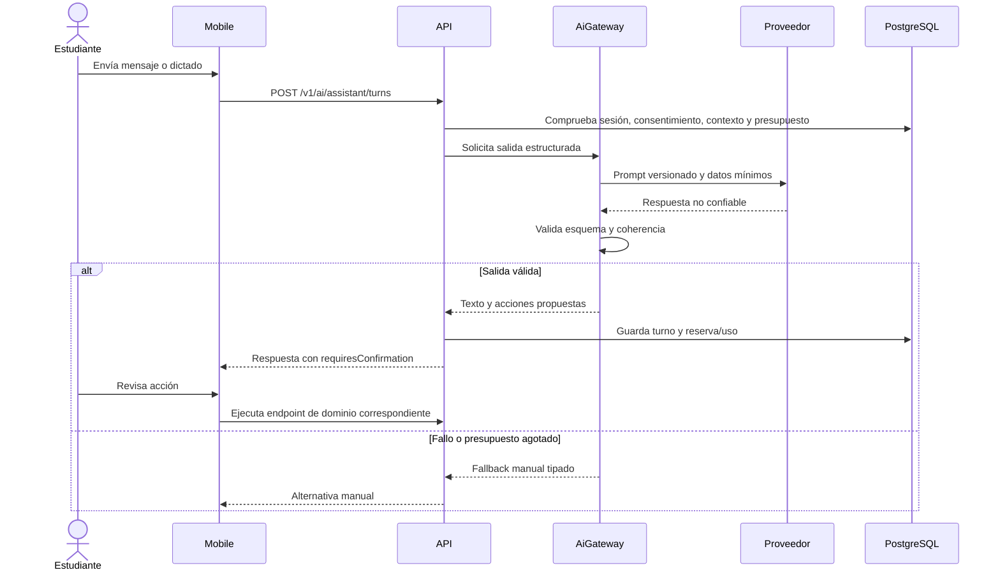

## 13. API

### 13.1 Convenciones

- base path `/v1` y JSON;
- instantes ISO 8601 UTC y fechas locales `YYYY-MM-DD`;
- UUID como identificadores públicos;
- DTO validados con Zod; no se serializan filas ORM;
- cookie de sesión; no se confía en roles enviados por el cliente;
- `Idempotency-Key` UUID para mutaciones reintentables cubiertas;
- `version` para control optimista;
- paginación por cursor opaco;
- tamaño máximo general de mutación: 128 KiB;
- cabeceras `X-Request-Id`, `traceparent`, `Cache-Control: no-store` y `X-Content-Type-Options: nosniff`;
- errores `application/problem+json`.

Ejemplo:

```json
{
  "type": "https://notesia.local/problems/version-conflict",
  "title": "El recurso cambió; actualízalo.",
  "status": 409,
  "code": "VERSION_CONFLICT",
  "requestId": "uuid"
}
```

### 13.2 Inventario por módulo

| Módulo | Rutas principales |
|---|---|
| Salud | `GET /health`, `GET /ready` |
| Auth | sesión, registro, login, logout, verificación, recuperación y TOTP bajo `/auth/*` |
| Perfil | `GET /me`, `PATCH /me/profile`, onboarding y preferencias |
| Actividades | CRUD, resumen, historial, progreso y transiciones bajo `/activities` |
| Series | lista, detalle y creación en `/activity-series` |
| Subtareas | lista, alta, detalle, edición, archivo y restauración bajo la actividad |
| Horas ocupadas | CRUD, archivo y restauración en `/calendar-events` |
| Disponibilidad | reglas, excepciones y capacidad en `/availability-*` |
| Planes | preview, plan activo, historial, detalle, bloques, apply y reject |
| Riesgo | `GET /risk-assessments` |
| Tiempo | lista, sesión activa, start, stop, manual y estadísticas |
| Racha | `GET /streak` |
| Avisos | lista, contador, leído, todos leídos y preferencias |
| Push | lista, registro y baja en `/me/push-devices` |
| IA | sugerencias por caso, onboarding, sesiones, turnos y decisiones del asistente |
| Privacidad | documentos, consentimientos y revocación de IA |
| Cuenta | exportación y solicitud/cancelación de eliminación |
| Reportes | lista y creación del estudiante |
| Admin | me, usuarios, roles, reportes, anuncios, IA, privacidad, auditoría y salud |

El inventario normativo completo y sus esquemas se encuentran en [`contracts/openapi.yaml`](contracts/openapi.yaml).

### 13.3 Idempotencia y concurrencia

La API guarda durante 24 horas el resultado de las mutaciones cubiertas. La clave se asocia a usuario, método, ruta y hash del cuerpo. Reusar la clave con otro contenido o mientras el primer intento continúa produce conflicto. El lease dura dos minutos y se renueva mientras la solicitud se procesa.

Las rutas de auth, admin, IA, consentimiento, exportación y eliminación tienen controles propios y quedan fuera del middleware general de idempotencia. El control optimista evita sobrescribir cambios hechos desde otro dispositivo.

## 14. Persistencia

### 14.1 Principios

- PostgreSQL 16+ es la fuente transaccional;
- esquemas `autenticacion` y `dominio`;
- identificadores SQL en español `snake_case`; enums públicos en inglés;
- `timestamptz` para instantes y zona IANA en perfil;
- constraints y claves foráneas para invariantes locales;
- tombstones para sincronización de entidades seleccionadas;
- secretos cifrados o referenciados, nunca en texto plano;
- auditoría y consentimiento append-only;
- migraciones compartidas inmutables y rollbacks explícitos.

### 14.2 Grupos de tablas vigentes

| Grupo | Tablas representativas |
|---|---|
| Auth | `usuarios`, `cuentas`, `almacen_seguro`, `segundos_factores`, `roles_usuario`, correos cifrados de verificación/recuperación |
| Perfil | `perfiles_usuario`, `preferencias_usuario`, `preferencias_avisos` |
| Trabajo | `series_actividades`, `actividades`, `subtareas`, `historial_actividades`, `registros_tiempo` |
| Horario | `eventos_calendario`, `reglas_disponibilidad`, `excepciones_disponibilidad`, `ventanas_excepcion` |
| Planificación | `revisiones_planificacion`, `planes`, `bloques_plan`, `trabajo_no_asignado`, `riesgos_plan`, `riesgos_actuales`, `planificacion_automatica` |
| IA | `proveedores_ia`, `rutas_ia`, `uso_ia`, `transiciones_ia`, `sin_respuesta_ia`, `sesiones_asistente`, `sugerencias_asistente` |
| Avisos | `bandeja_salida`, `notificaciones`, `dispositivos_push`, `envios_push`, `anuncios` |
| Privacidad/soporte | `documentos_privacidad`, `consentimientos`, `solicitudes_eliminacion`, `auditoria_eliminaciones`, `reportes`, `historial_reportes` |
| Operación | `claves_idempotencia`, `auditoria_admin`, `latido_procesos`, `configuracion_sistema` |
| Racha | `dias_racha`, `progreso_descanso_racha` |

### 14.3 Restricciones destacadas

- un solo plan activo por usuario mediante índice parcial;
- una sola sesión de tiempo abierta por usuario;
- exclusión de solapamiento entre bloques activos;
- duración y progreso válidos;
- fin posterior a inicio;
- plazo no anterior a inicio mínimo;
- rutas IA únicas por caso de uso;
- notificación única por origen o referencia cuando aplica;
- actividad, evento, regla y perfil con versión positiva;
- credenciales, push y tokens cifrados antes de persistir.

Las 66 migraciones de `packages/db/migrations` son la fuente de verdad evolutiva. `database/schema.sql` es un DDL histórico incompleto y no representa por sí solo el estado actual.

## 15. Offline y sincronización móvil

El alcance es offline tolerante. El usuario puede leer datos cacheados y encolar operaciones simples; planificación, IA, autenticación inicial y administración requieren red.

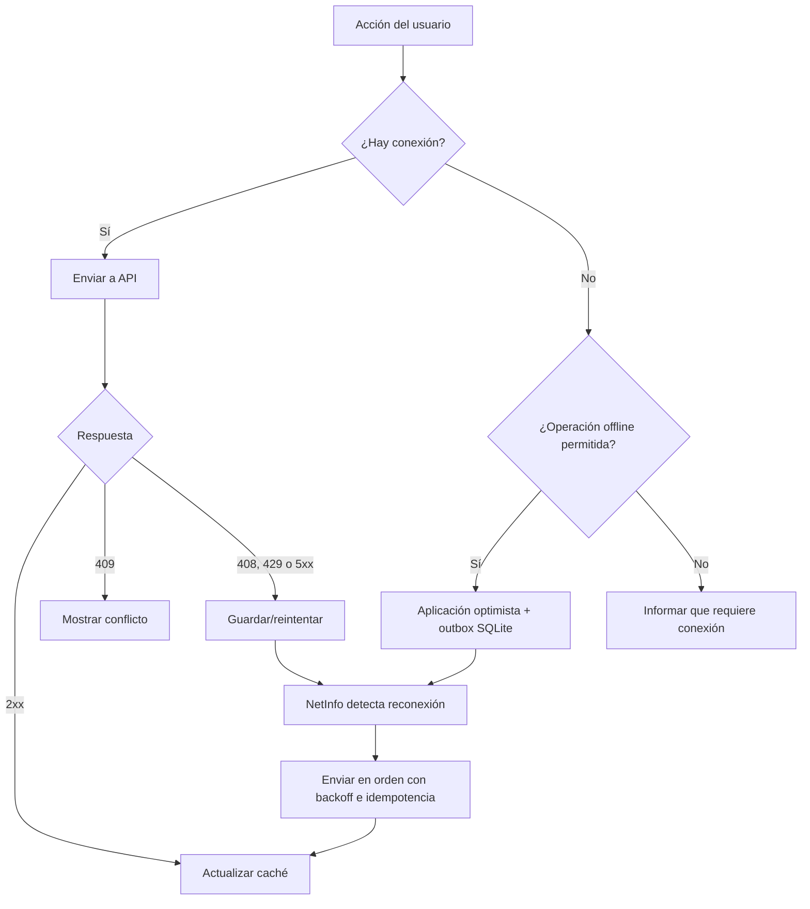

La cola local se separa por alcance de sesión, limita tamaño y cantidad, usa backoff exponencial con jitter y conserva conflictos para resolución explícita. El cierre de sesión limpia material asociado a la sesión según las políticas del cliente.

## 16. Inteligencia artificial

### 16.1 Casos configurables

- `extract_activity`;
- `estimate_duration`;
- `explain_risk`;
- `explain_replan`;
- `propose_subtasks`;
- `assistant_chat`;
- `onboarding_setup`.

### 16.2 Controles

1. comprobar consentimiento vigente;
2. seleccionar una ruta habilitada por caso de uso;
3. reservar presupuesto diario;
4. minimizar y redactar la entrada;
5. invocar proveedor con modelo explícito, timeout y límite de salida;
6. validar el JSON contra esquema;
7. comprobar coherencia con datos determinísticos;
8. registrar tokens, duración, estado y costo sin prompt completo;
9. intentar proveedor alterno solo ante causas configuradas;
10. devolver fallback manual tipado si no puede responder.

Las claves se cifran con `AI_ENCRYPTION_KEY`, son write-only y nunca regresan al panel. Los identificadores de modelo que terminan en `latest` son rechazados.

## 17. Seguridad y privacidad

### 17.1 Controles principales

| Riesgo | Control implementado o exigido |
|---|---|
| Acceso horizontal | Repositorios acotados por `user_id` y pruebas de acceso cruzado. |
| Robo de sesión | Cookie protegida; Keychain/Keystore móvil; sesiones cifradas, revocables y ligadas a versión de cuenta. |
| Enumeración de correo | Respuestas uniformes en registro, verificación y recuperación. |
| Contraseña expuesta | Argon2id; nunca se registra ni persiste en claro. |
| Escalada administrativa | Rol en servidor, MFA obligatorio, sesión fresca, rate limit y auditoría. |
| CSRF/origen administrativo | Validación del origen exacto en mutaciones sensibles. |
| Reintento duplicado | Idempotency key, mutation ID y constraints únicos. |
| Payload abusivo | límite general de 128 KiB y validación estricta. |
| Secretos IA/push | cifrado en servidor, respuesta write-only y comprobación de bundle. |
| Prompt injection | contenido tratado como dato, sin acceso general a DB y salida estructurada validada. |
| Filtración en logs | observaciones por allowlist, sin URL completa, query, cuerpos, correo ni errores crudos. |
| Bloques manipulados | validación completa del plan en el servidor. |
| Cuenta suspendida | incremento de versión de cuenta e invalidación de sesiones anteriores. |

### 17.2 Datos y protección

| Dato | Clasificación | Protección |
|---|---|---|
| Contraseña | secreto | hash Argon2id |
| Cookie/token de sesión | secreto | cifrado servidor + almacén seguro cliente |
| API key de IA | crítico | AES-GCM/envelope; write-only |
| Token push | sensible | cifrado antes de PostgreSQL |
| Correo/perfil | personal | autorización y exclusión de logs |
| Actividades/agenda | personal | alcance por usuario y minimización para IA |
| Consentimientos | legal | versión, fecha e historial inmutable |
| Auditoría | sensible | acceso administrativo y retención |

## 18. Notificaciones y procesos diferidos

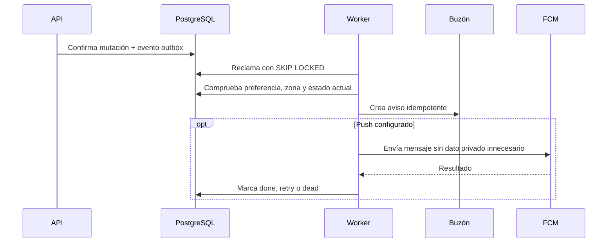

El worker también:

- entrega correos de verificación y recuperación;
- recalcula riesgo cada 15 minutos o tras cambios;
- crea recordatorios de plazo, bloque, riesgo y racha;
- ejecuta planificación automática;
- procesa eliminaciones vencidas;
- reconcilia reservas de IA abandonadas;
- purga sesiones, claves idempotentes, cuentas no verificadas, planes y avisos expirados;
- actualiza su latido para el panel de salud.

## 19. Observabilidad

- logs JSON estructurados para API y worker;
- `X-Request-Id` por petición;
- propagación W3C `traceparent` y contexto asíncrono;
- trazas entre API, PostgreSQL y worker mediante contexto persistido mínimo;
- métricas HTTP por área, estado y duración;
- salud de colas: pending, ready, in-flight, dead y antigüedad;
- salud del worker por último latido;
- IA por proveedor: éxito, indisponibilidad, error, tokens, costo, promedio y p95;
- alertas por worker ausente, backlog, dead letters, proveedor caído, tasa de error y costo;
- webhook operativo firmado y deduplicable cuando se configura.

No deben observarse cuerpos, prompts completos, SQL, parámetros, correo, tokens ni respuestas crudas de proveedores.

## 20. Despliegue

### 20.1 Topología prevista

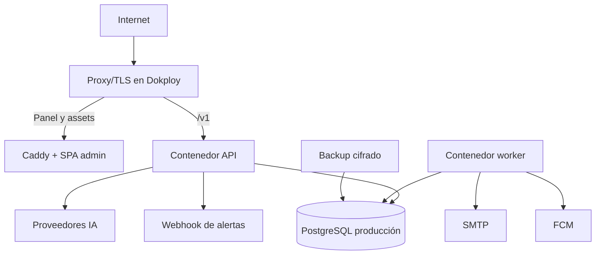

### 20.2 Servicios

| Servicio | Imagen/entrada | Salud |
|---|---|---|
| API | `Dockerfile.api`, `bun dist/api/index.js` | `/v1/health` y `/v1/ready` |
| Worker | `Dockerfile.worker`, `bun dist/worker/index.js` | latido en PostgreSQL |
| Admin | `Dockerfile.admin`, Caddy y SPA | entrega HTTP estática |
| PostgreSQL | externo/administrado | comprobado por readiness |

### 20.3 Configuración por entorno

Variables obligatorias o condicionales:

- base: `DATABASE_URL`, `BETTER_AUTH_SECRET`, `NODE_ENV`;
- API pública: `BETTER_AUTH_URL`, `ADMIN_ORIGIN`, `API_HOST`, `PORT`;
- móvil: `NOTESIA_API_BASE_URL` de compilación, HTTPS en release;
- registro/correo: `ALLOW_SIGNUP`, `SMTP_*`, `PASSWORD_RESET_URL`;
- IA: `AI_ENCRYPTION_KEY`;
- push: `PUSH_ENCRYPTION_KEY`, `FCM_PROJECT_ID` y credencial de servicio;
- eliminación: plazos y clave de auditoría aprobados;
- operación: webhook, secreto, origen, intervalos y umbral de costo;
- backup: `BACKUP_ENCRYPTION_KEY` fuera del repositorio.

En producción, las migraciones se ejecutan desde el entorno local con las credenciales protegidas de `.pgpass`, después de verificar conexión, respaldo y propietario de la aplicación. Se prohíben `migrate:fresh`, `db:wipe`, seeders de demostración y rollback automático.

## 21. Desarrollo, calidad y pruebas

### 21.1 Comandos del repositorio

```bash
bun run dev:api
bun run dev:worker
bun run dev:admin
bun run dev:mobile
bun run lint
bun run typecheck
bun run test
bun run build
bun run contracts:check
```

El script `./iniciar-notesia-local.sh` prepara la ejecución local coordinada. Metro usa el puerto `8082`, la API usa por defecto `3000` y el panel Vite `5173`.

### 21.2 Pirámide de pruebas

| Nivel | Cobertura esperada |
|---|---|
| Unitarias | disponibilidad, tiempo, recurrencia, planificación, riesgo, racha, mensajes push, configuración y validadores |
| Integración PostgreSQL | repositorios, transacciones, outbox, idempotencia, auth, planes, riesgo, notificaciones, IA y acceso cruzado |
| Componentes móvil | formularios, loading, vacío, error, offline, navegación, accesibilidad y conflictos |
| Componentes admin | permisos, formularios, claves write-only, confirmaciones, filtros y paginación |
| E2E | acceso administrativo y flujos críticos de estudiante |
| Seguridad | sin sesión, sesión vencida, rol incorrecto, recurso ajeno, payload inválido y rate limit |
| Contrato | OpenAPI generado sin divergencia con Zod |
| Operación | backup/restauración, bundle sin secretos, rendimiento y cierre ordenado |

### 21.3 Definición de terminado

Un cambio está terminado cuando satisface aceptación, validación, autorización, error, vacío y conectividad; tiene pruebas proporcionales; actualiza contratos, migraciones y documentación; no filtra secretos o PII; y pasa lint, tipos, pruebas y build.

## 22. Decisiones de arquitectura vigentes

| ADR | Decisión |
|---|---|
| ADR-0001 | Clientes separados de DB y proveedores por una API. |
| ADR-0002 | Reemplazado por ADR-0007. |
| ADR-0003 | Planificación y riesgo determinísticos. |
| ADR-0004 | Gateway multi proveedor para IA. |
| ADR-0005 | Offline tolerante y acotado. |
| ADR-0006 | Better Auth 1.7.5 con sesiones protegidas en PostgreSQL. |
| ADR-0007 | React Native CLI y Metro sin Expo. |

## 23. Hallazgos, divergencias y riesgos pendientes

| Prioridad | Hallazgo | Impacto | Acción recomendada |
|---|---|---|---|
| Crítica | El worker aplica planes automáticamente sin confirmación (`auto-planner.ts`), mientras las reglas obligatorias prohíben aplicar recomendaciones o replanificaciones de forma automática. | Pérdida de control del usuario y contradicción de dominio. | Cambiar el worker para producir una propuesta revisable o aprobar formalmente una nueva decisión y actualizar reglas, UX y criterios. |
| Alta | `docs/PRODUCT_REQUIREMENTS.md` y partes de `docs/LOCAL_DEVELOPMENT.md` aún describen materias y periodos eliminados en `0052`. | Requisitos y pruebas pueden apuntar a funciones inexistentes. | Actualizar esos documentos y retirar RF obsoletos. |
| Alta | `database/schema.sql` no contiene entidades añadidas por migraciones recientes. | Un entorno creado solo desde ese DDL queda incompleto. | Generar un snapshot vigente o declarar las migraciones como único bootstrap. |
| Media | Algunos documentos describen solo notificaciones internas, mientras el código actual incluye dispositivos y entrega FCM. | Confusión de despliegue y pruebas. | Unificar la documentación operativa de push. |
| Media | La política de retención depende de configuración aprobada y parte de la eliminación queda deshabilitada si falta. | Cumplimiento incompleto en un entorno mal configurado. | Aprobar plazos, documentarlos y verificar la configuración antes de producción. |
| Media | La importación desde imagen/PDF y calendarios externos permanece en roadmap. | Captura manual más costosa. | Mantener fuera del MVP hasta validar el flujo central. |

## 24. Roadmap coherente con el repositorio

1. Resolver la contradicción de aplicación automática de planes.
2. Consolidar requisitos y DDL con el estado real de migraciones.
3. Completar validación de producción: SMTP, FCM, retención, backup/restauración y alertas.
4. Ejecutar auditoría de accesibilidad de los flujos críticos móviles.
5. Medir objetivos p95 con carga representativa.
6. Tras validar el MVP, evaluar importación de horarios, calendarios externos, widgets y estimación avanzada.

## 25. Glosario

| Término | Definición |
|---|---|
| Actividad | Trabajo académico, examen, asunto personal o rutina. |
| Hora ocupada | Evento fijo que resta capacidad al horario. |
| Franja de estudio | Intervalo semanal en el que el usuario acepta planificar trabajo. |
| Plan draft | Vista previa editable aún no activa. |
| Plan activo | Única versión aplicada para un usuario. |
| Revisión de fuentes | Contador que cambia cuando una entrada de planificación se modifica. |
| Trabajo no asignado | Minutos que el motor no pudo ubicar y su causa. |
| Margen | Capacidad disponible menos trabajo restante. |
| Outbox | Patrón que guarda evento y mutación de negocio en la misma transacción. |
| Tombstone | Marca de borrado lógico conservada para sincronización. |
| Sesión fresca | Sesión administrativa creada después de MFA o del cambio sensible requerido. |
| Fallback manual | Respuesta tipada que permite continuar sin IA. |

## 26. Fuentes internas consultadas

- [`APP_CONTEXT.md`](APP_CONTEXT.md)
- [`ARCHITECTURE.md`](ARCHITECTURE.md)
- [`DATABASE_SCHEMA.md`](DATABASE_SCHEMA.md)
- [`contracts/openapi.yaml`](contracts/openapi.yaml)
- [`packages/contracts/src/index.ts`](packages/contracts/src/index.ts)
- [`packages/domain/src`](packages/domain/src)
- [`packages/db/migrations`](packages/db/migrations)
- [`apps/api/src`](apps/api/src)
- [`apps/worker/src`](apps/worker/src)
- [`apps/mobile/src`](apps/mobile/src)
- [`apps/admin/src`](apps/admin/src)
- [`docs/decisions`](docs/decisions)
- [`rules`](rules)

---

Este documento describe el sistema observado en el repositorio a la fecha de corte. Los cambios de contrato, dominio, migraciones, seguridad o despliegue deben actualizarlo en el mismo cambio vertical.
